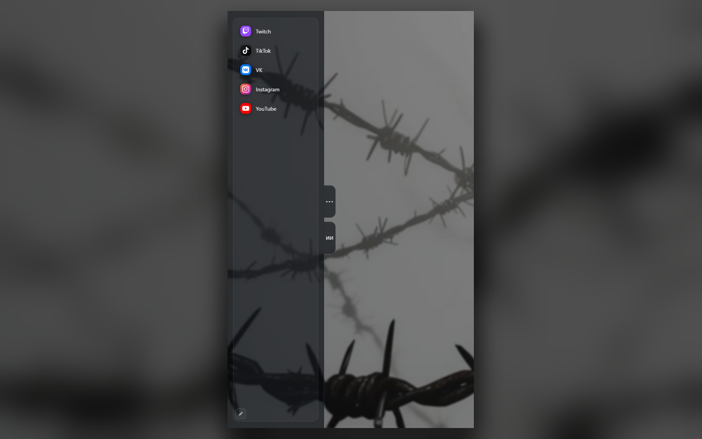
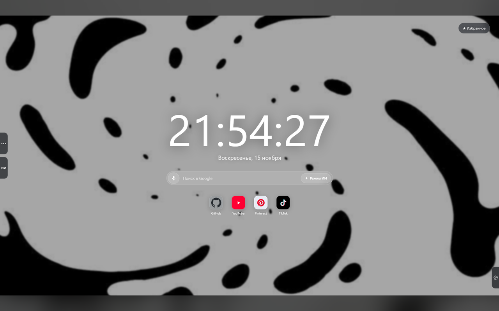

# Startspace

Настраиваемая новая вкладка для Chromium: часы, поиск, быстрые ссылки, избранное, погода, курсы валют и боковые панели ИИ.

## Возможности

- Часы и дата с настройкой секунд, прозрачности и толщины.
- Поиск в Google, Яндексе, DuckDuckGo или Bing, кнопка «Режим ИИ» и голосовой ввод, если он поддерживается браузером.
- Быстрые ссылки с разными формами плиток и аккуратными иконками.
- Избранное: выпадающая панель с закладками браузера без копирования их в данные расширения.
- Погода на неделю и курсы валют с графиком — оба виджета можно отключить.
- Боковые панели ИИ и соцсетей с редактированием списка и настройкой прозрачности.
- Свой фон: фото или видео, затемнение, размытие, история фонов и рекомендованные обои.
- Акцентный цвет интерфейса для кнопок, ползунков и панелей.

## Скриншоты

### Новая вкладка

### Панель ИИ

### Панель соцсетей

### Настройки

### Альтернативные обои

## Установка

1. Скачайте `startspace-1.0.0.zip` из [релиза](https://github.com/Sevensyof/Startspace/releases/tag/v1.0.0) или клонируйте репозиторий.
2. Откройте `chrome://extensions`.
3. Включите режим разработчика.
4. Нажмите «Загрузить распакованное расширение» и выберите папку с `manifest.json`.

## Приватность и разрешения

Настройки, история фонов и добавленные ссылки хранятся локально в `chrome.storage.local`. Расширение не использует аккаунт, синхронизацию и аналитику.

- `storage`, `unlimitedStorage` — настройки и фоны.
- `bookmarks` — показ избранного из закладок браузера.
- `api.met.no`, `api.open-meteo.com`, `geocoding-api.open-meteo.com`, `www.cbr-xml-daily.ru`, `t3.gstatic.com` — погода, курсы валют и иконки сайтов.

Подробное описание для Chrome Web Store: [`store/description.md`](store/description.md).
