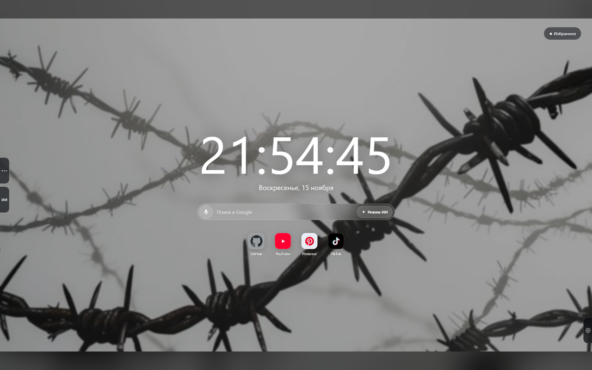
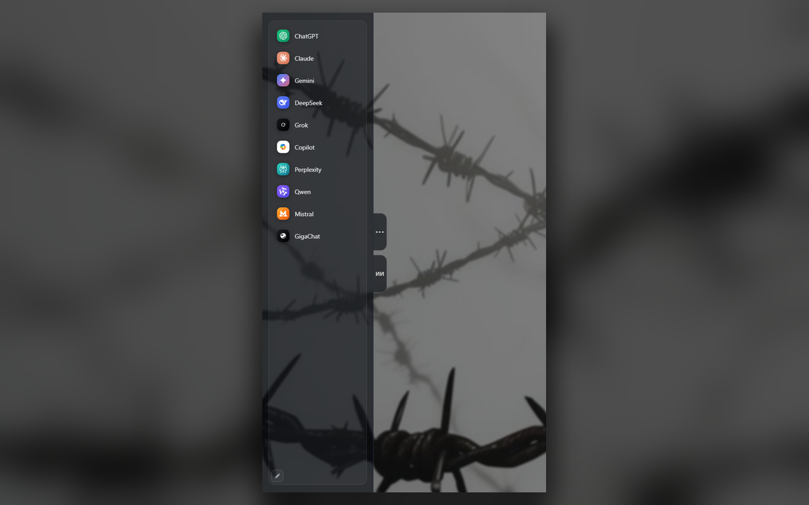
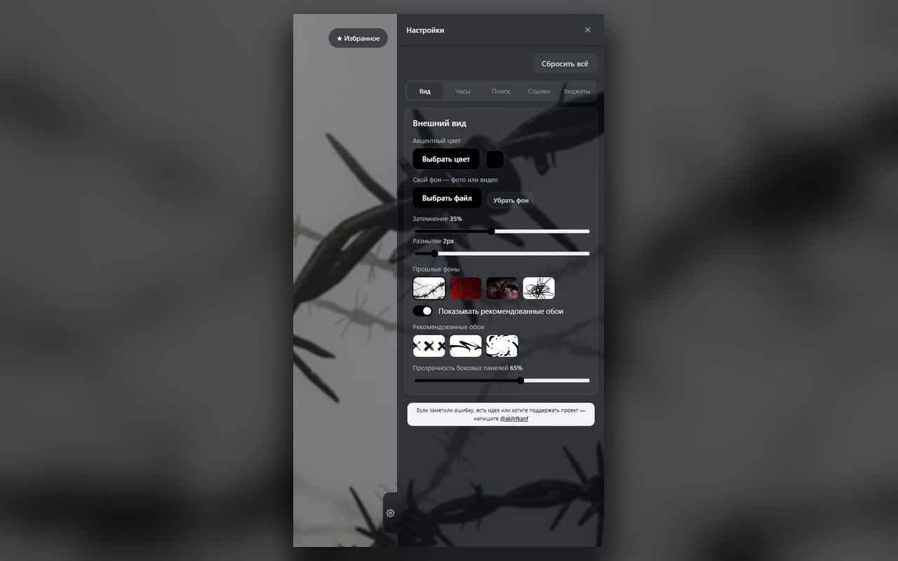

<p align="center">
  
</p>

<h1 align="center">Startspace</h1>

<p align="center">Настраиваемая новая вкладка для Chrome и Firefox: часы, поиск, избранное, погода, курсы валют и боковые панели.</p>



## Возможности

- Часы и дата с настройкой секунд, прозрачности и толщины.
- Поиск в Google, Яндексе, DuckDuckGo или Bing, кнопка «Режим ИИ» и голосовой ввод, если он поддерживается браузером.
- Быстрые ссылки с разными формами плиток и аккуратными иконками.
- Избранное: выпадающая панель с закладками браузера без копирования их в данные расширения.
- Погода на неделю и курсы валют с графиком — оба виджета можно отключить.
- Боковые панели ИИ и соцсетей с редактированием списка и настройкой прозрачности.
- Свой фон: фото или видео, затемнение, размытие, история фонов и рекомендованные обои.
- Акцентный цвет интерфейса для кнопок, ползунков и панелей.

## Скриншоты

### Новая вкладка


### Панель ИИ



### Панель соцсетей


### Настройки



### Альтернативные обои


## Установка

Доступно для **Chrome / Chromium** и **Firefox**.

### Chrome / Chromium

1. Скачайте `startspace-1.0.2.zip` из [последнего релиза](https://github.com/Sevensyof/Startspace/releases/latest).
2. Распакуйте архив.
3. Откройте `chrome://extensions` и включите режим разработчика.
4. Нажмите «Загрузить распакованное расширение» и выберите папку с `manifest.json`.

### Firefox

1. Скачайте `startspace-1.0.2-signed.xpi` из [последнего релиза](https://github.com/Sevensyof/Startspace/releases/latest).
2. Откройте файл в Firefox и подтвердите установку.
3. Откройте новую вкладку — Startspace уже там.

Для разработки можно загрузить папку `firefox/` через `about:debugging#/runtime/this-firefox` как временное дополнение. Голосовой ввод в Firefox недоступен: кнопка автоматически скрывается.

Проверка и сборка:

```bash
npx web-ext lint --source-dir firefox
npx web-ext build --source-dir firefox
```


## Приватность и разрешения

Настройки, история фонов и добавленные ссылки хранятся локально в `chrome.storage.local`. Расширение не использует аккаунт, синхронизацию и аналитику.

- `storage`, `unlimitedStorage` — настройки и фоны.
- `bookmarks` — показ избранного из закладок браузера.
- `api.met.no`, `api.open-meteo.com`, `geocoding-api.open-meteo.com`, `www.cbr-xml-daily.ru`, `t3.gstatic.com` — погода, курсы валют и иконки сайтов.

Подробное описание для Chrome Web Store: [`store/description.md`](store/description.md).
